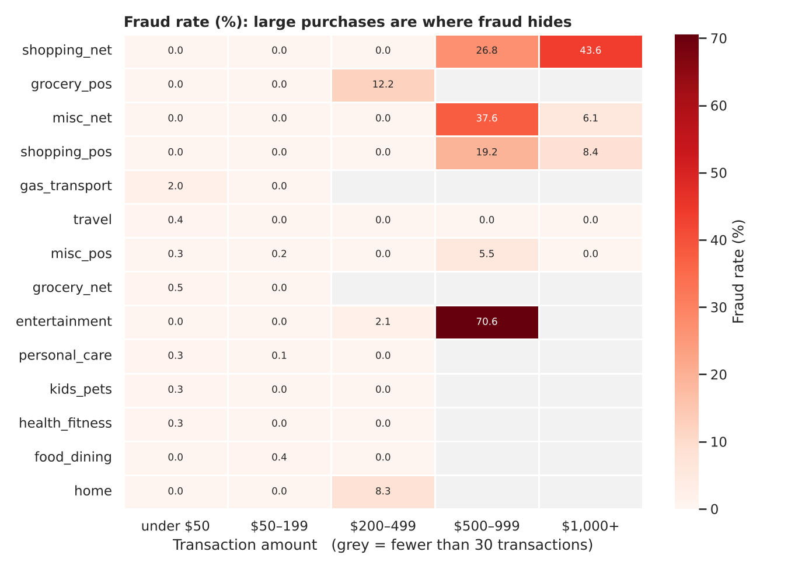
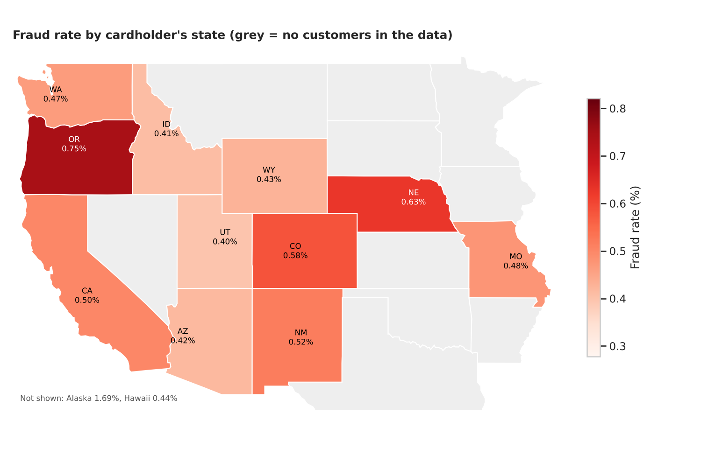
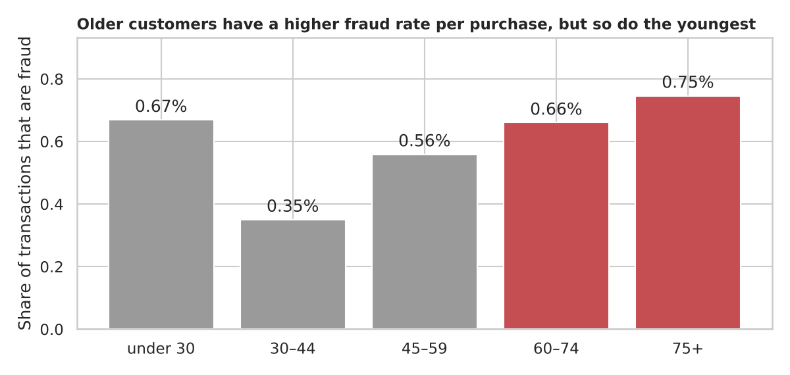
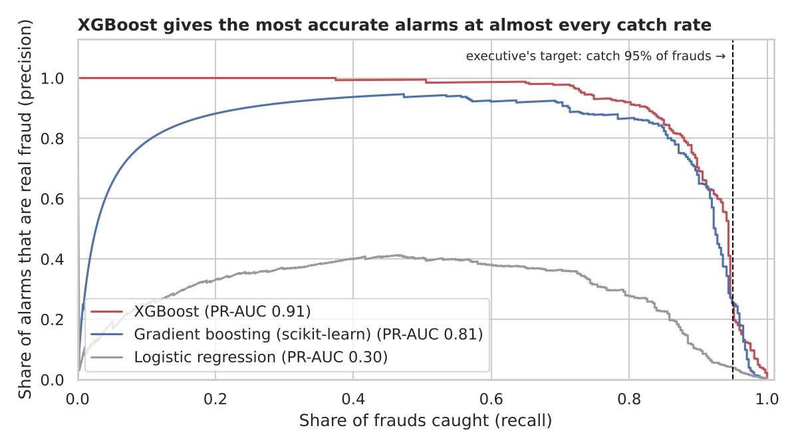
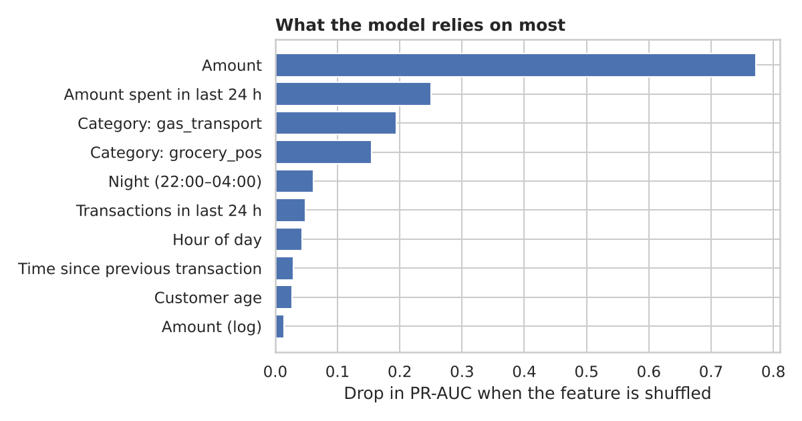

# Credit Card Fraud Detection

Can a card company spot fraud the moment a payment happens, and catch almost all of it without blocking good customers all the time?

Using 339,607 card payments, I built a model that **caught 353 of 374 frauds (94%)** in six months of data it had never seen, while flagging **fewer than 1 in 100 payments**. About **half of the alarms were real fraud**, roughly **2 false alarms a day** across the whole customer base.



## The question

A new credit card company in the western United States wants to market itself as one of the safest cards to use. The executive's brief was: predict fraud as accurately as possible, and **err on the side of caution**. Checking a good payment by mistake is acceptable; letting a fraud through is not.

Four questions guided the work:

1. Which purchases (type and amount) are most likely to be fraud?
2. Where are fraud rates highest (by state)?
3. Are older customers more likely to be victims?
4. How well can fraud be predicted, if we would rather raise a false alarm than miss a fraud?

## The data

- 339,607 card payments from January 2019 to December 2020, by 187 cardholders living in 13 western states. Each payment is labelled fraud or not: **1,782 frauds (0.52%)**.
- Source: DataCamp's version of a public Kaggle dataset. The payments are **simulated** with a tool that imitates real card use, so patterns are cleaner than they would be in a real bank.
- No missing values and no duplicates.
- Two things I had to work out myself:
  - There is no customer ID. Each cardholder has a unique date of birth, so date of birth + job + city identifies a customer.
  - The data dictionary says `lat`/`long` is where the purchase happened. In fact it never changes for a customer, so it is the **cardholder's home**. The purchase location is `merch_lat`/`merch_long`.

## What I did

1. **Checked the data** in SQL (DuckDB): counts, missing values, duplicates, and what each column really means.
2. **Explored fraud** by purchase type, amount, time of day, state and age.
3. **Tested the age question** with statistics that account for the same customer making many payments.
4. **Built features a bank knows at the moment of payment**, in SQL with window functions ([`sql/01_features.sql`](sql/01_features.sql)): how many payments the card made in the last hour and day, how this amount compares with the customer's usual spending over the last 30 days, minutes since the previous payment, first visit to this merchant, night-time, and so on. Every feature only looks at **earlier** payments, so the model never sees the future.
5. **Trained three models** (logistic regression, scikit-learn gradient boosting and XGBoost) on January 2019 – June 2020 and **tested them on July – December 2020**, as a bank would use past data to protect the coming months.
6. **Set the alarm level to match the brief:** on an earlier period I chose the level that catches at least 95% of frauds, then applied that fixed level to the test months.

Accuracy alone would be misleading here: a model that never flags anything is 99.5% accurate and catches nothing. So I report the **share of frauds caught (recall)** and the **share of alarms that are real fraud (precision)**.

## Findings

### 1. Large purchases are where fraud hides

| Amount | Share that is fraud |
|---|---|
| Under $50 | 0.2% |
| $50–199 | 0.04% |
| $200–499 | 4.0% |
| $500–999 | 20.8% |
| $1,000+ | 20.4% |

- By type, **online shopping (1.44%)**, **in-store groceries (1.32%)** and **other online purchases (1.28%)** have the highest fraud rates, about 9 times the safest types (home, health and fitness, food and dining at about 0.15%).
- The typical fraud is about **$356**; the typical normal payment is **$46**. Online shopping above $1,000 is fraud in 44% of cases.
- Exception: fraud at **gas stations and transport** is small (about $11). This fits the known pattern of small test charges made to check that a stolen card works.

### 2. Fraud by state: no reliable pattern



Oregon (0.75%) and Nebraska (0.63%) are highest on the mainland, and Alaska is highest overall (1.69%). But the data has only 187 customers and some states have very few (Alaska 4, Hawaii 2), so one unlucky customer can move a state's rate a lot. **State is not a dependable warning sign in this data.**

### 3. Older customers: higher rate per purchase, not more frauds per person



- Per payment, the fraud rate is higher for customers **60+ (0.69%) than under 60 (0.47%)**. Allowing for repeated payments by the same person, the odds of fraud rise by about **10% per decade of age** (95% CI 4–17%, p = 0.002).
- Per person, older and younger customers suffer about the **same number of frauds (about 10 each)**. Older customers simply make fewer normal purchases, so fraud is a bigger share of their card use.
- The youngest group (under 30) also has a high rate; the lowest is 30–44.

So older customers are not targeted more often, but fraud weighs more on their account. Extra alerts for them would be a cheap safety measure.

### 4. Fraud can be predicted well, while erring on the side of caution

| Model | Frauds caught | Alarms that are real fraud | Payments flagged | False alarms per day |
|---|---|---|---|---|
| Logistic regression | 95% | 4% | 9.5% | 48 |
| Gradient boosting (scikit-learn) | 94% | 39% | 0.9% | 3.0 |
| **XGBoost** | **94%** | **49%** | **0.75%** | **2.0** |



XGBoost works best because fraud depends on **combinations**: a large amount *and* night-time *and* a busy card. A simple straight-line model (logistic regression) can only catch the same share of fraud by flagging ten times as many payments.

**The alarm level is a business choice.** With the same model:

| Frauds caught | Frauds missed (of 374) | False alarms per day |
|---|---|---|
| 80% | 74 | 0.1 |
| 90% | 37 | 0.8 |
| 95% | 18 | 5.6 |
| 98% | 7 | 19 |
| 99% | 3 | 48 |

**What fraud looks like** (fraud vs normal payments):

| | Fraud | Normal |
|---|---|---|
| Amount compared with customer's usual spending (median) | 4.1× | 0.65× |
| Made at night (22:00–04:00) | 86% | 23% |
| Minutes since previous payment (median) | 73 | 264 |
| First payment at this merchant | 47% | 29% |
| Distance from home to merchant (median) | 77 km | 78 km |

Distance from home makes no difference, so it does not help in this data.



## Conclusions

1. **Fraud is very predictable in this data.** The model catches about 94% of frauds while checking fewer than 1% of payments.
2. **The cautious rule works.** The alarm level was fixed in advance to catch 95% of frauds. The company can move it: 98% is possible at about 19 false alarms a day.
3. **Warning signs:** a large payment (several times the usual amount), at night, soon after other payments, often online shopping or in-store groceries, sometimes after small test charges at gas stations.
4. **Older customers** deserve extra alerts: fraud is a bigger share of their card use.

**Recommendations:** send flagged payments to a quick check (an SMS or app confirmation) instead of blocking them; retrain the model every month; test it on real payments before relying on these numbers.

**Limits:** the data is simulated and has only 187 customers; the costs of a false alarm and of a missed fraud were not given, so the alarm level follows the executive's instruction rather than a cost calculation.

## Repository

```
├── fraud_detection.ipynb     full analysis: data checks, questions 1–4, model, conclusions
├── sql/01_features.sql       feature building in DuckDB (window functions, no look-ahead)
├── data/
│   ├── credit_card_fraud.csv.gz   339,607 payments (compressed)
│   └── us_states.geojson          state shapes for the map (PublicaMundi/MappingAPI)
├── figures/                  charts used in this README
└── results/                  result tables (CSV)
```

## How to run

```bash
pip install -r requirements.txt
jupyter notebook fraud_detection.ipynb     # run all cells from the project folder (about 1–2 minutes)
```

The notebook builds a local DuckDB file (`fraud.duckdb`) from the compressed CSV the first time it runs.

## Tools

SQL (DuckDB) · Python (pandas, NumPy, SciPy, statsmodels) · scikit-learn · XGBoost · Matplotlib, Seaborn
